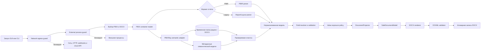

# PBIX Converter

Офлайн-приложение на Python, которое внутри корпоративной Windows-сессии получает один отчёт Power BI в формате `.pbix` и создаёт один человекочитаемый файл документации `.docx`, подготовленный для ручного импорта в Atlassian Confluence Data Center.

Программа предназначена для технического описания отчёта: показывает листы, визуальные элементы, используемые поля, фильтры, вычисления, закладки, переходы между листами и доступную часть семантической модели. Детальные строки данных в документацию не попадают; сохранённые значения фильтров читаются только из метаданных отчёта.

## Текущее состояние

Версия приложения: `0.4.1`.

На текущем этапе реализован рабочий локальный прототип:

- графический запуск с системными окнами Проводника;
- обработка PBIR и Legacy `Report/Layout`;
- извлечение листов, визуалов, полей, фильтров и действий;
- извлечение закладок, их групп и привязки к листам;
- построение входящих и исходящих переходов между листами;
- чтение локальной семантической модели через PBIXRay;
- безопасное профилирование категориальных колонок;
- единый реестр полей с DAX, форматами, NativeQuery, листами, визуалами и агрегациями;
- сопоставление одноимённых показателей, зависимостей и контекстов фильтрации;
- формирование компактного DOCX целиком в альбомной ориентации;
- проверка безопасности OOXML перед атомарной публикацией DOCX;
- политика `VDI_OFFLINE_RUNTIME`, запрещающая сетевые операции и запуск внешних процессов;
- временная обработка рядом с выбранным DOCX с обязательной проверкой очистки;
- частичный результат, если отдельная часть PBIX недоступна;
- синтетический PBIX-контейнер и пример DOCX для сквозной проверки приложения;
- 29 автоматических тестов.

Приложение ещё не проверено на реальном корпоративном PBIX. Поэтому поддержку редких вариантов внутренней структуры отчёта и интерпретацию RLS/OLS нельзя считать окончательно подтверждёнными.

## Работа внутри Citrix VDI

В этом проекте «локально» означает внутри удалённой Windows-сессии Citrix. Программа не ограничивает пользователя конкретным диском или каталогом: через Проводник можно выбрать любой путь, который разрешён и виден в VDI, включая корпоративную сетевую папку.

Во время анализа программа не создаёт HTTP-запросы или серверы, не открывает сетевые сокеты, не отправляет вебхуки и телеметрию, не вызывает Git, браузер, пакетный менеджер или облачный клиент. До загрузки GUI и анализаторов устанавливаются две независимые Python-политики: `NetworkEgressGuard` блокирует сетевые операции, а `ExternalProcessGuard` — делегирование работы внешнему процессу. Любое срабатывание является фатальной ошибкой, а не частичным результатом.

Эти политики защищают от случайного сетевого вызова приложения или зависимости, но не являются песочницей Windows. Они не контролируют нативный код вне CPython audit events, другие процессы, каналы Citrix или выбранный пользователем UNC/mapped путь. Если выбрать сетевую папку, Windows может использовать SMB. Системный сетевой доступ, перенаправление клиентских дисков, буфера обмена, USB и печати контролируются администраторами Citrix, firewall и AppLocker/WDAC.

Программа обращается только к выбранному PBIX, каталогу выбранного DOCX и собственным временным файлам. Абсолютный путь к PBIX в DOCX не записывается. Если временную папку не удаётся удалить, операция завершается фатальной ошибкой и новый DOCX не публикуется.

## Как пользоваться через PyCharm

### 1. Подготовить интерпретатор

Требуется 64-битный Python 3.11–3.13. В среде разработки из корня проекта выполните:

```powershell
python -m pip install -e .
```

Команда установит проект в текущий интерпретатор и добавит зафиксированные зависимости `pbixray==0.15.4` и `python-docx==1.2.0`.

В защищённой VDI установка должна выполняться из подготовленного офлайн-релиза, без обращения к PyPI:

```powershell
.\install_offline.ps1
.\run_pbix_doc.ps1
```

Офлайн-релиз предварительно собирается на отдельной машине командой `scripts\build_offline_release.ps1`. Он содержит wheel приложения, полный набор зависимостей с зафиксированными версиями и SHA-256, итоговый `SHA256SUMS` и не содержит `.git`. Текущий lock рассчитан на Windows x64 и CPython 3.11–3.13.

### 2. Запустить приложение

Запустите файл `main.py` кнопкой Run в PyCharm или командой:

```powershell
python main.py
```

После запуска:

1. В первом окне Проводника выберите входной `.pbix`.
2. Во втором окне выберите папку и имя выходного `.docx`.
3. Дождитесь сообщения о завершении обработки.

Тяжёлая обработка выполняется в отдельном потоке, поэтому окно прогресса не должно зависать.

### 3. Проверить результат

В выбранной папке появится DOCX. В паспорте документа указывается итоговый статус:

- `OK` — основные части отчёта извлечены без предупреждений;
- `PARTIAL` — документация создана, но часть метаданных недоступна или не разрешена;
- `FAILED` — не удалось извлечь ни одного листа отчёта.

`PARTIAL` не означает, что исходный отчёт Power BI повреждён. Например, такой статус ожидаем для thin/live-отчёта без локальной семантической модели.

Готовый DOCX можно загрузить в Confluence Data Center через штатную команду **Import Word Document**. Confluence может переоформить шрифты, ширины и разрывы страниц, поэтому документ использует стандартные `Heading 1–3`, нативные таблицы Word и видимые локальные ID.

## Быстрая проверка на синтетическом PBIX

В проект включён файл:

```text
examples/synthetic_representative.pbix
```

Он содержит:

- 3 листа, включая скрытый Tooltip;
- 11 визуальных элементов;
- карточки, диаграмму, матрицу, срез и условный custom visual;
- 2 сгруппированные закладки;
- переходы на листы, по закладкам и на Tooltip;
- ссылки на колонки, меры и агрегации;
- фильтры с тестовыми значениями для проверки отображения сохранённого состояния.

Запустите `main.py`, выберите этот файл и сохраните результат. Эталон уже сформирован в:

```text
examples/synthetic_representative_documentation.docx
```

Синтетический контейнер не содержит бинарную семантическую модель `DataModel`. Для него ожидаются статусы `NO_MODEL` и `PARTIAL`. Расширение `.pbix` позволяет проверить наше приложение через обычный интерфейс, но файл не заявлен как отчёт, открываемый Power BI Desktop.

Повторно собрать контейнер можно командой:

```powershell
python examples\build_synthetic_pbix.py
```

## Запуск из командной строки

Графический интерфейс является основным способом работы. Для автоматизации доступен CLI:

```powershell
python main.py "C:\Reports\report.pbix" "C:\Reports\report_documentation.docx"
```

После установки проекта доступна эквивалентная команда:

```powershell
pbix-doc "C:\Reports\report.pbix" "C:\Reports\report_documentation.docx"
```

Параметры CLI:

| Параметр | Назначение |
|---|---|
| `--examples N` | Количество категориальных примеров, принудительно ограниченное диапазоном `0–5`. По умолчанию `5` |
| `--no-examples` | Полностью отключить чтение примеров значений |
| `--version` | Показать версию приложения |

Код возврата `0` означает `OK`. Код `2` означает, что DOCX создан, но итоговый статус отличается от `OK` (`PARTIAL` или `FAILED`). Обычная ошибка чтения или записи возвращает код `1`. Код `4` зарезервирован для фатального нарушения runtime-политики VDI; такое нарушение никогда не преобразуется в частичный DOCX.

## Что попадает в выходной DOCX

Документ содержит следующие основные разделы:

1. Сведения о входном файле, SHA-256, версиях компонентов и статусах извлечения.
2. Общие сведения об отчёте и фильтры уровня отчёта.
3. Единый реестр всех полей отчёта.
4. Единую таблицу «Состав листа» по визуалам, элементам управления и закладкам.
5. Одноимённые показатели и возможные различия методологии или контекста.
6. Каталог KPI, зависимостей и санитизированного DAX.
7. Путеводитель по листам и визуальным элементам.
8. Закладки, связанные листы, кнопки, навигаторы, Tooltip и drillthrough.
9. Прямые пользовательские маршруты.
10. Доступную часть семантической модели, включая таблицы, колонки и связи.
11. Наличие Power Query и типы подключений.
12. RLS и OLS.

Реестр полей расположен сразу после фильтров уровня отчёта. Его 11 колонок идут в фиксированном порядке: `Таблица[Поле]`, варианты названий, тип данных в PBI, пустое ручное объяснение, DAX, листы, имя и тип в источнике, использования в DAX, визуалы и варианты агрегаций. Служебные `Local*` и `DateTableTemplate_*` не включаются. Для отсутствующих исходных метаданных ставится `—`; числовые коды типов и агрегаций преобразуются в названия, а варианты агрегаций выводятся через запятую (`По умолчанию, SUM, COUNT`). NativeQuery, M и SQL не выполняются и целиком в документ не переносятся.

Сразу за реестром располагается таблица **«Состав листа»**. Одна строка соответствует визуалу, элементу управления или закладке; в ней собраны назначение, поля и показатели, связанный DAX, фильтры, закладки и действие. Контекст фильтра показывает только область и поле (`Фильтр листа: Таблица[Поле]`), без неоднозначных технических литералов. Только колонка `Элемент` содержит самостоятельный локальный ID. В остальных местах ссылка записывается человекочитаемо: `Исходный вид (B01)`, `Детали (P02)`, `Выручка (V003)`.

## Работа с закладками и навигацией

Для каждой найденной закладки программа старается определить:

- технический ID и отображаемое имя;
- группу и порядок;
- связанный лист;
- scope сохранённого состояния;
- затронутые визуалы;
- элементы отчёта, которые активируют закладку.

Для перехода сохраняется цепочка:

```text
исходный лист → визуальный элемент → тип действия → цель → связанный лист
```

На основании этих данных для каждого листа рассчитываются исходящие и входящие переходы. Поддерживаются переходы на листы, закладки, Tooltip-страницы, drillthrough, внешние URL и динамическое действие «назад», если соответствующие метаданные присутствуют.

## Политика обработки значений

Основной принцип: документировать устройство отчёта, а не переносить в DOCX его фактические данные.

Применяются следующие правила:

| Категория | Поведение |
|---|---|
| Строки таблиц | Никогда не записываются |
| Результаты мер | Не вычисляются |
| Значения фильтров, срезов и закладок | До 20 уникальных значений из метаданных каждого объекта |
| Числовые значения | Не выводятся как примеры |
| Даты и время | Не выводятся как примеры |
| ID, ключи, GUID | Не выводятся как примеры |
| Login, UPN, e-mail, телефон, account | Не выводятся как примеры |
| Категориальный текст | До пяти наиболее частых значений без частот |
| Power Query и NativeQuery | Фиксируются безопасные метаданные, полный текст не выводится и не выполняется |
| Секреты подключений | Не выводятся |

Колонки-кандидаты читаются блоками до 250 000 значений. В нормализованную модель передаются только итоговые разрешённые примеры. Значения фильтров и закладок берутся из конфигурации отчёта, а не из строк таблиц. `DocumentProjector` получает только нормализованные метаданные, а DOCX-рендерер — только безопасную документную модель без строк исходных таблиц.

## RLS и OLS

Если локальная модель содержит доступные метаданные, программа выводит определения ролей, затронутые таблицы или колонки и очищенные выражения. Раздел не помечается как заглушка. Значения логинов, UPN, пользователей и назначения ролей не выводятся.

Корпоративная схема с отдельной таблицей доступов должна быть проверена на реальном рабочем PBIX. До такого прогона программа не утверждает:

- кто фактически назначен в роль в Power BI Service;
- какие пользователи реально имеют доступ;
- что динамическая RLS-цепочка интерпретирована полностью;
- что Service-side назначения присутствуют в локальном файле.

## Как устроена программа



Сырая структура PBIX заканчивается на адаптерах. `DocumentProjector` строит реестр полей, состав листов, зависимости, сравнения контекстов, карточки закладок и индексы переходов только из нормализованной модели. DOCX-рендерер получает `SafeDocumentModel`, не читает PBIX и не получает строки таблиц. Перед публикацией итоговый OOXML проверяется на макросы, OLE/ActiveX, внешние связи, remote templates, внешние hyperlinks, автоматические поля и небезопасные ZIP-части.

Главные части проекта:

| Файл | Ответственность |
|---|---|
| `main.py` | Простая точка запуска для PyCharm |
| `src/pbix_doc/bootstrap.py` | Ранняя установка runtime-политик до импорта GUI и анализаторов |
| `src/pbix_doc/gui.py` | Окна выбора файлов и отображение прогресса |
| `src/pbix_doc/cli.py` | Аргументы командной строки |
| `src/pbix_doc/container.py` | Безопасное чтение ZIP-структуры PBIX |
| `src/pbix_doc/report.py` | Разбор PBIR, Legacy, полей, фильтров, закладок и переходов |
| `src/pbix_doc/semantic.py` | Работа с PBIXRay, NativeQuery-метаданными и безопасным профилированием колонок |
| `src/pbix_doc/domain.py` | Нормализованные структуры данных |
| `src/pbix_doc/pipeline.py` | Последовательность обработки и проверка результата |
| `src/pbix_doc/projector.py` | Пользовательская проекция, реестр полей, DAX-зависимости и навигационные индексы |
| `src/pbix_doc/renderer.py` | Word-стили, таблицы и атомарное формирование DOCX |
| `src/pbix_doc/ooxml.py` | Проверка безопасности OOXML перед публикацией |
| `src/pbix_doc/runtime.py` | Раздельные запреты сети и внешних процессов, управление временными файлами |
| `tests/test_converter.py` | Модульные и сквозные проверки |

Программа не обращается к Power BI Service, Fabric API, внешним LLM или облачным сервисам. Временная папка создаётся рядом с выбранным DOCX и должна быть удалена до продолжения формирования документа. При следующем запуске повторно очищаются оставленные после аварии временные каталоги, если создавший их процесс уже завершён.

## Внутренняя диагностика

Неразрешённая ссылка означает, что программа нашла упоминание поля или меры, но не смогла уверенно сопоставить его с объектом локальной модели.

Частые причины:

- PBIX является thin/live-отчётом;
- локальная семантическая модель отсутствует;
- custom visual использует собственную структуру привязок;
- применён новый вариант PBIR;
- объект модели был переименован или не извлечён.

Такая ссылка не доказывает ошибку в исходном отчёте. Неразрешённые ссылки и техническая диагностика остаются во внутреннем результате и консоли, но в DOCX не включаются. Постоянный log-файл не создаётся.

## Проверка проекта

Запуск тестов:

```powershell
python -m unittest discover -s tests -v
```

Проверяются:

- PBIR с листами, полями, закладкой и переходами;
- Legacy Layout в UTF-16LE;
- отклонение повреждённого контейнера;
- ограниченное извлечение значений фильтров и сохранённого состояния закладок;
- ограничение примеров пятью значениями;
- исключение логинов, e-mail, ID и числовых колонок;
- полный проход `.pbix → .docx` без встроенной модели;
- отсутствие абсолютного пути PBIX в DOCX;
- реестр полей из 11 колонок, DAX-зависимости, визуалы и агрегации;
- извлечение типов только из `Value.NativeQuery` и `Table.TransformColumnTypes`;
- детерминированное формирование DOCX и проверка OOXML;
- запрет внешних OOXML-связей;
- запрет сетевых операций и запуска внешних процессов;
- ранняя установка guard и невозможность преобразовать нарушение политики в `PARTIAL`;
- создание и очистка временной рабочей папки;
- фатальная остановка без замены DOCX при ошибке очистки;
- удаление оставленного после сбоя рабочего каталога;
- отсутствие пользовательского `--temp-dir` и компактные ошибки без traceback.

Последний локальный прогон: 29 тестов, все завершены успешно. Синтетический PBIX состоит из 23 ZIP-частей и собирается детерминированно.

## Известные ограничения

- Нет подтверждённого прогона на корпоративном PBIX с реальной моделью.
- Синтетический `.pbix` проверяет наш анализатор, но не заявлен как Desktop-совместимый отчёт.
- Thin/live-отчёт не содержит удалённую семантическую модель, поэтому её таблицы, меры и RLS могут быть недоступны локально.
- Новые версии PBIR и нестандартные custom visuals могут дать частичный результат.
- Настройка Power BI «Изменить взаимодействия» между визуалами пока не извлекается.
- Полные тексты Power Query и NativeQuery намеренно не переносятся в DOCX.

## Следующий этап

Для перехода от прототипа к подтверждённой версии нужен первый реальный PBIX. После него необходимо:

1. Сравнить фактический DOCX с отчётом в Power BI Desktop.
2. Проверить все типы закладок и навигационных действий.
3. Проверить встроенную модель, меры, связи, NativeQuery-метаданные и безопасные примеры.
4. Проверить импорт DOCX через **Import Word Document** в корпоративном Confluence.
5. Проверить корпоративную таблицу логинов и динамическую RLS без вывода идентификаторов.
6. Зафиксировать встретившиеся варианты метаданных отдельными обезличенными тестами.
7. Скорректировать RLS/OLS только на основании фактической структуры.

## Разработка и поставка в VDI

Git используется только для разработки исходного кода. Корпоративные PBIX не должны добавляться в репозиторий или обрабатываться в синхронизируемом каталоге разработки.

Поставка в VDI создаётся скриптом `scripts\build_offline_release.ps1`. В неё входят только wheel-файлы, точные версии и разрешённые хеши зависимостей, скрипты установки и запуска и контрольные суммы. Установка использует `pip --no-index`; `.git`, тестовые отчёты, Яндекс Диск и сетевые загрузки в production-поставку не входят.

## Справочные материалы

- [Официальное описание папки отчёта PBIP и формата PBIR](https://learn.microsoft.com/en-us/power-bi/developer/projects/projects-report)
- [Официальная структура определения отчёта Microsoft Fabric](https://learn.microsoft.com/en-us/rest/api/fabric/articles/item-management/definitions/report-definition)
- [`ARCHITECTURE.md`](ARCHITECTURE.md) — утверждённая целевая архитектура и ограничения проекта.
