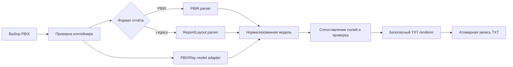

# PBIX Converter

Локальное приложение на Python, которое получает один отчёт Power BI в формате `.pbix` и создаёт один человекочитаемый файл документации `.txt`.

Программа предназначена для технического описания отчёта: показывает листы, визуальные элементы, используемые поля, фильтры, закладки, переходы между листами и доступную часть семантической модели. Детальные строки данных и сохранённые значения фильтров в документацию не попадают.

## Текущее состояние

Версия приложения: `0.1.0`.

На текущем этапе реализован рабочий локальный прототип:

- графический запуск с системными окнами Проводника;
- обработка PBIR и Legacy `Report/Layout`;
- извлечение листов, визуалов, полей, фильтров и действий;
- извлечение закладок, их групп и привязки к листам;
- построение входящих и исходящих переходов между листами;
- чтение локальной семантической модели через PBIXRay;
- безопасное профилирование категориальных колонок;
- формирование итогового TXT в UTF-8 с BOM и Windows-переносами строк;
- частичный результат, если отдельная часть PBIX недоступна;
- синтетический PBIX-контейнер для сквозной проверки приложения;
- 7 автоматических тестов.

Приложение ещё не проверено на реальном корпоративном PBIX. Поэтому поддержку редких вариантов внутренней структуры отчёта и интерпретацию RLS/OLS нельзя считать окончательно подтверждёнными.

## Как пользоваться через PyCharm

### 1. Подготовить интерпретатор

Требуется Python 3.11 или новее. В терминале PyCharm из корня проекта выполните:

```powershell
python -m pip install -e .
```

Команда установит проект в текущий интерпретатор и добавит зафиксированную зависимость `pbixray==0.15.4`.

### 2. Запустить приложение

Запустите файл `main.py` кнопкой Run в PyCharm или командой:

```powershell
python main.py
```

После запуска:

1. В первом окне Проводника выберите входной `.pbix`.
2. Во втором окне выберите папку и имя выходного `.txt`.
3. Дождитесь сообщения о завершении обработки.

Тяжёлая обработка выполняется в отдельном потоке, поэтому окно прогресса не должно зависать.

### 3. Проверить результат

В выбранной папке появится TXT. В конце файла указывается итоговый статус:

- `OK` — основные части отчёта извлечены без предупреждений;
- `PARTIAL` — документация создана, но часть метаданных недоступна или не разрешена;
- `FAILED` — не удалось извлечь ни одного листа отчёта.

`PARTIAL` не означает, что исходный отчёт Power BI повреждён. Например, такой статус ожидаем для thin/live-отчёта без локальной семантической модели.

## Быстрая проверка на синтетическом PBIX

В проект включён файл:

```text
examples/synthetic_representative.pbix
```

Он содержит:

- 3 листа, включая скрытый Tooltip;
- 11 визуальных элементов;
- карточки, диаграмму, матрицу, срез и условный custom visual;
- 2 сгруппированные закладки;
- переходы на листы, по закладкам и на Tooltip;
- ссылки на колонки, меры и агрегации;
- фильтры с тестовыми значениями, которые не должны появиться в TXT.

Запустите `main.py`, выберите этот файл и сохраните результат. Эталон уже сформирован в:

```text
examples/synthetic_representative_documentation.txt
```

Синтетический контейнер не содержит бинарную семантическую модель `DataModel`. Для него ожидаются статусы `NO_MODEL` и `PARTIAL`. Расширение `.pbix` позволяет проверить наше приложение через обычный интерфейс, но файл не заявлен как отчёт, открываемый Power BI Desktop.

Повторно собрать контейнер можно командой:

```powershell
python examples/build_synthetic_pbix.py
```

## Запуск из командной строки

Графический интерфейс является основным способом работы. Для автоматизации доступен CLI:

```powershell
python main.py "C:\Reports\report.pbix" "C:\Reports\report_documentation.txt"
```

После установки проекта доступна эквивалентная команда:

```powershell
pbix-doc "C:\Reports\report.pbix" "C:\Reports\report_documentation.txt"
```

Параметры CLI:

| Параметр | Назначение |
|---|---|
| `--examples N` | Максимальное количество категориальных примеров для одной колонки. По умолчанию `5` |
| `--no-examples` | Полностью отключить чтение примеров значений |
| `--temp-dir PATH` | Использовать указанную локальную папку для временных файлов |
| `--version` | Показать версию приложения |

Код возврата `0` означает `OK`. Код `2` означает, что TXT создан, но итоговый статус отличается от `OK` (`PARTIAL` или `FAILED`). Ошибка чтения или записи завершает процесс ненулевым кодом и выводит причину.

## Что попадает в выходной TXT

Документ содержит следующие основные разделы:

1. Сведения о входном файле, SHA-256 и версиях компонентов.
2. Статусы извлечения по подсистемам.
3. Общие сведения об отчёте и фильтры уровня отчёта.
4. Список листов.
5. Закладки, связанные листы и точки входа.
6. Общий граф переходов.
7. Отдельный раздел для каждого листа:
   - свойства листа;
   - визуальные элементы и координаты;
   - используемые поля и агрегации;
   - фильтры;
   - связанные закладки;
   - исходящие и входящие переходы.
8. Доступная часть семантической модели:
   - таблицы и колонки;
   - безопасные примеры категорий;
   - меры и DAX;
   - связи.
9. Наличие Power Query и типы подключений.
10. Формальная секция RLS/OLS.
11. Неразрешённые ссылки.
12. Диагностика извлечения.

## Работа с закладками и навигацией

Для каждой найденной закладки программа старается определить:

- технический ID и отображаемое имя;
- группу и порядок;
- связанный лист;
- затронутые визуалы;
- элементы отчёта, которые активируют закладку.

Для перехода сохраняется цепочка:

```text
исходный лист → визуальный элемент → тип действия → цель → связанный лист
```

На основании этих данных для каждого листа рассчитываются исходящие и входящие переходы. Поддерживаются переходы на листы, закладки, Tooltip-страницы, drillthrough, внешние URL и динамическое действие «назад», если соответствующие метаданные присутствуют.

## Политика обработки значений

Основной принцип: документировать устройство отчёта, а не переносить в TXT его фактические данные.

Применяются следующие правила:

| Категория | Поведение |
|---|---|
| Строки таблиц | Никогда не записываются |
| Результаты мер | Не вычисляются |
| Значения фильтров и срезов | Заменяются на `<VALUES HIDDEN>` |
| Числовые значения | Не выводятся как примеры |
| Даты и время | Не выводятся как примеры |
| ID, ключи, GUID | Не выводятся как примеры |
| Login, UPN, e-mail, телефон, account | Не выводятся как примеры |
| Категориальный текст | До пяти наиболее частых значений без частот |
| Power Query | Фиксируется наличие, текст выражения не выводится |
| Секреты подключений | Не выводятся |

Колонки-кандидаты читаются блоками до 250 000 значений. В нормализованную модель передаются только итоговые разрешённые примеры. TXT-рендерер не получает строки исходных таблиц.

## RLS и OLS

Секция безопасности сейчас имеет статус `PROVISIONAL`.

Если локальная модель содержит доступные метаданные, программа выводит определения ролей, затронутые таблицы или колонки и очищенные выражения. Значения логинов, UPN, пользователей и назначения ролей не выводятся.

Корпоративная схема с отдельной таблицей доступов должна быть проверена на реальном рабочем PBIX. До такого прогона программа не утверждает:

- кто фактически назначен в роль в Power BI Service;
- какие пользователи реально имеют доступ;
- что динамическая RLS-цепочка интерпретирована полностью;
- что Service-side назначения присутствуют в локальном файле.

## Как устроена программа



Главные части проекта:

| Файл | Ответственность |
|---|---|
| `main.py` | Простая точка запуска для PyCharm |
| `src/pbix_doc/gui.py` | Окна выбора файлов и отображение прогресса |
| `src/pbix_doc/cli.py` | Аргументы командной строки |
| `src/pbix_doc/container.py` | Безопасное чтение ZIP-структуры PBIX |
| `src/pbix_doc/report.py` | Разбор PBIR, Legacy, полей, фильтров, закладок и переходов |
| `src/pbix_doc/semantic.py` | Работа с PBIXRay и безопасное профилирование колонок |
| `src/pbix_doc/domain.py` | Нормализованные структуры данных |
| `src/pbix_doc/pipeline.py` | Последовательность обработки и проверка результата |
| `src/pbix_doc/renderer.py` | Формирование и атомарная запись TXT |
| `tests/test_converter.py` | Модульные и сквозные проверки |

Программа не обращается к Power BI Service, Fabric API, внешним LLM или облачным сервисам. Временная папка создаётся локально и удаляется после обработки.

## Неразрешённые ссылки и диагностика

Неразрешённая ссылка означает, что программа нашла упоминание поля или меры, но не смогла уверенно сопоставить его с объектом локальной модели.

Частые причины:

- PBIX является thin/live-отчётом;
- локальная семантическая модель отсутствует;
- custom visual использует собственную структуру привязок;
- применён новый вариант PBIR;
- объект модели был переименован или не извлечён.

Такая ссылка не доказывает ошибку в исходном отчёте. Для проверки в TXT сохраняются причина и путь к исходному элементу метаданных.

## Проверка проекта

Запуск тестов:

```powershell
python -m unittest discover -s tests -v
```

Проверяются:

- PBIR с листами, полями, закладкой и переходами;
- Legacy Layout в UTF-16LE;
- отклонение повреждённого контейнера;
- скрытие фильтров и сохранённого состояния закладок;
- ограничение примеров пятью значениями;
- исключение логинов, e-mail, ID и числовых колонок;
- UTF-8 BOM и CRLF;
- полный проход `.pbix → .txt` без встроенной модели.

Последний локальный прогон: 7 тестов, все завершены успешно. Синтетический PBIX состоит из 22 ZIP-частей и собирается детерминированно.

## Известные ограничения

- Нет подтверждённого прогона на корпоративном PBIX с реальной моделью.
- Синтетический `.pbix` проверяет наш анализатор, но не заявлен как Desktop-совместимый отчёт.
- Thin/live-отчёт не содержит удалённую семантическую модель, поэтому её таблицы, меры и RLS могут быть недоступны локально.
- RLS/OLS остаётся формальной заглушкой до боевого прогона.
- Новые версии PBIR и нестандартные custom visuals могут дать частичный результат.
- Тексты Power Query намеренно не переносятся в TXT.

## Следующий этап

Для перехода от прототипа к подтверждённой версии нужен первый реальный PBIX. После него необходимо:

1. Сравнить фактический TXT с отчётом в Power BI Desktop.
2. Проверить все типы закладок и навигационных действий.
3. Проверить встроенную модель, меры, связи и безопасные примеры.
4. Проверить корпоративную таблицу логинов и динамическую RLS без вывода идентификаторов.
5. Зафиксировать встретившиеся варианты метаданных отдельными обезличенными тестами.
6. Скорректировать RLS/OLS только на основании фактической структуры.

## Подготовка к публикации

Публикация в Git пока не выполнялась. После утверждения этой документации и отдельной команды владельца проекта планируется передать проект через Git-коннектор.

Целевая структура в репозитории:

```text
pbix converter/
├── README.md
├── ARCHITECTURE.md
├── pyproject.toml
├── main.py
├── src/
├── tests/
└── examples/
```

В публикацию должны войти исходный код, тесты, примеры, синтетический PBIX, эталонные TXT и проектная документация. Служебные каталоги интерпретатора (`__pycache__`, `*.egg-info`, `.venv`) исключаются правилами `.gitignore`.

## Справочные материалы

- [Официальное описание папки отчёта PBIP и формата PBIR](https://learn.microsoft.com/en-us/power-bi/developer/projects/projects-report)
- [Официальная структура определения отчёта Microsoft Fabric](https://learn.microsoft.com/en-us/rest/api/fabric/articles/item-management/definitions/report-definition)
- `ARCHITECTURE.md` — утверждённая целевая архитектура и ограничения проекта.
