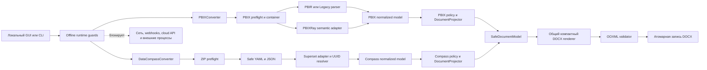

# PBIX & Data Compass Documentation Converters

Набор из двух независимых офлайн-конвертеров для корпоративной Windows/Citrix VDI. Они преобразуют локальные метаданные BI-отчёта в компактный `.docx`, подготовленный для ручного импорта в Atlassian Confluence Data Center.

| Конвертер | Вход | Выход | Что описывает |
|---|---|---|---|
| `PBIXConverter.exe` | Один Power BI `.pbix` | Один `.docx` | Листы, визуалы, поля, DAX, фильтры, закладки, переходы, Power Query и локальную семантическую модель |
| `DataCompassConverter.exe` | Один export Data Compass / Apache Superset `.zip` | Один `.docx` | Дашборд, вкладки, визуалы, datasets, поля, метрики, фильтры, SQL-выражения и взаимодействия |

Оба приложения читают только выбранный файл, не выполняют DAX, M, SQL или Jinja и не переносят в DOCX детальные строки данных. Сохранённые значения фильтров берутся только из локальной конфигурации отчёта.

## Текущее состояние

Версия приложения: `0.5.0`.

На текущем этапе реализованы два рабочих локальных конвертера. PBIX Converter поддерживает:

- графический запуск с системными окнами Проводника;
- обработка PBIR и Legacy `Report/Layout`;
- извлечение листов, визуалов, полей, фильтров и действий;
- извлечение закладок, их групп и привязки к листам;
- построение входящих и исходящих переходов между листами;
- чтение локальной семантической модели через PBIXRay;
- безопасное профилирование категориальных колонок;
- единый реестр полей с DAX, форматами, NativeQuery, листами, визуалами и агрегациями;
- сопоставление одноимённых показателей, зависимостей и контекстов фильтрации;
- формирование компактного DOCX целиком в альбомной ориентации;
- проверка безопасности OOXML перед атомарной публикацией DOCX;
- политика `VDI_OFFLINE_RUNTIME`, запрещающая сетевые операции и запуск внешних процессов;
- временная обработка рядом с выбранным DOCX с обязательной проверкой очистки;
- частичный результат, если отдельная часть PBIX недоступна;
- синтетический PBIX-контейнер и пример DOCX для сквозной проверки приложения;
- набор автоматических тестов.

Data Compass Converter поддерживает:

- безопасный preflight ZIP и YAML/JSON с лимитами;
- разбор database, dataset, chart, dashboard layout и native filters;
- реестр полей, saved/ad-hoc метрик и источников;
- восстановление вкладок, состава дашборда, scope/exclusions фильтров и явных взаимодействий;
- сравнение одинаковых названий по определению и контексту;
- отдельный автономный `DataCompassConverter.exe`.

Поддержка ещё не подтверждена на обезличенных корпоративных PBIX и Data Compass export. Поэтому редкие варианты внутренней структуры, custom visuals/plugins, RLS/OLS и фирменные расширения Data Compass могут дать `PARTIAL` до боевой приёмки.

## Работа внутри Citrix VDI

В этом проекте «локально» означает внутри удалённой Windows-сессии Citrix. Программа не ограничивает пользователя конкретным диском или каталогом: через Проводник можно выбрать любой путь, который разрешён и виден в VDI, включая корпоративную сетевую папку.

Во время анализа программа не создаёт HTTP-запросы или серверы, не открывает сетевые сокеты, не отправляет вебхуки и телеметрию, не вызывает Git, браузер, пакетный менеджер или облачный клиент. До загрузки GUI и анализаторов устанавливаются две независимые Python-политики: `NetworkEgressGuard` блокирует сетевые операции, а `ExternalProcessGuard` — делегирование работы внешнему процессу. Любое срабатывание является фатальной ошибкой, а не частичным результатом.

Эти политики защищают от случайного сетевого вызова приложения или зависимости, но не являются песочницей Windows. Они не контролируют нативный код вне CPython audit events, другие процессы, каналы Citrix или выбранный пользователем UNC/mapped путь. Если выбрать сетевую папку, Windows может использовать SMB. Системный сетевой доступ, перенаправление клиентских дисков, буфера обмена, USB и печати контролируются администраторами Citrix, firewall и AppLocker/WDAC.

Программа обращается только к выбранному PBIX или Data Compass ZIP, каталогу выбранного DOCX и собственным временным файлам. Абсолютный путь к исходному файлу в DOCX не записывается. Если временную папку не удаётся удалить, операция завершается фатальной ошибкой и новый DOCX не публикуется.

## Самый простой запуск в Windows: готовые EXE

В ветке `test-source-types` оба файла лежат в корне репозитория рядом с архитектурными документами:

- для `.pbix` запустите `PBIXConverter.exe`;
- для Data Compass / Superset `.zip` запустите `DataCompassConverter.exe`.

После `git pull` или распаковки архива ветки запустите нужный EXE двойным щелчком. Оба EXE автономные: Python, PowerShell, `.venv`, установка библиотек, папка `_internal` и интернет для работы не требуются. Каждый EXE сначала проверяет встроенные компоненты, затем открывает окна выбора входного файла и выходного DOCX.

Если корпоративная защита запрещает single-file приложения, используйте ZIP с пометкой `windows-x64-exe` из GitHub Releases: это альтернативная сборка с отдельной папкой `_internal`.

## Как пользоваться через PyCharm

### 1. Подготовить интерпретатор

Требуется 64-битный Python 3.11–3.13. В среде разработки из корня проекта выполните:

```powershell
python -m pip install -e .
```

Команда установит проект в текущий интерпретатор и добавит зафиксированные зависимости `pbixray==0.15.4` и `python-docx==1.2.0`.

В защищённой VDI используйте офлайн-релиз для своей версии Python. Для CPython 3.12 x64 скачайте архив с суффиксом `cp312-win_amd64`, полностью распакуйте его в локальную папку и запустите:

```powershell
.\start_pbix_doc.cmd
```

При первом запуске пакет создаёт собственную `.venv` в распакованной папке и устанавливает приложение только из вложенного `wheelhouse` с `pip --no-index`. Интернет для установки и работы не используется. Последующие запуски используют уже созданную среду.

Офлайн-релиз предварительно собирается на отдельной машине командой `scripts\build_offline_release.ps1`. Он содержит wheel приложения, зависимости с зафиксированными версиями и SHA-256, итоговый `SHA256SUMS` и не содержит `.git` или готовую `.venv`. Каждый архив предназначен для одной minor-версии CPython; целевая версия по умолчанию — 3.12 x64.

### 2. Запустить приложение

Для Power BI запустите файл `main.py` кнопкой Run в PyCharm или командой:

```powershell
python main.py
```

Для Data Compass запустите:

```powershell
python -m data_compass
```

После запуска:

1. В первом окне Проводника выберите входной `.pbix` или Data Compass export `.zip` в зависимости от запущенного конвертера.
2. Во втором окне выберите папку и имя выходного `.docx`.
3. Дождитесь сообщения о завершении обработки.

Тяжёлая обработка выполняется в отдельном потоке, поэтому окно прогресса не должно зависать.

### 3. Проверить результат

В выбранной папке появится DOCX. В паспорте документа указывается итоговый статус:

- `OK` — основные части отчёта извлечены без предупреждений;
- `PARTIAL` — документация создана, но часть метаданных недоступна или не разрешена;
- `FAILED` — не удалось получить содержательный документ из выбранного отчёта или дашборда.

`PARTIAL` не означает, что исходный файл повреждён. Например, такой статус ожидаем для thin/live PBIX без локальной семантической модели или для Data Compass export с неизвестным custom `viz_type`.

Готовый DOCX можно загрузить в Confluence Data Center через штатную команду **Import Word Document**. Confluence может переоформить шрифты, ширины и разрывы страниц, поэтому документ использует стандартные `Heading 1–3`, нативные таблицы Word и видимые локальные ID.

## Быстрая проверка на синтетическом PBIX

В проект включён файл:

```text
examples/synthetic_representative.pbix
```

Он содержит:

- 3 листа, включая скрытый Tooltip;
- 11 визуальных элементов;
- карточки, диаграмму, матрицу, срез и условный custom visual;
- 2 сгруппированные закладки;
- переходы на листы, по закладкам и на Tooltip;
- ссылки на колонки, меры и агрегации;
- фильтры с тестовыми значениями для проверки отображения сохранённого состояния.

Запустите `main.py`, выберите этот файл и сохраните результат. Эталон уже сформирован в:

```text
examples/synthetic_representative_documentation.docx
```

Синтетический контейнер не содержит бинарную семантическую модель `DataModel`. Для него ожидаются статусы `NO_MODEL` и `PARTIAL`. Расширение `.pbix` позволяет проверить наше приложение через обычный интерфейс, но файл не заявлен как отчёт, открываемый Power BI Desktop.

Повторно собрать контейнер можно командой:

```powershell
python examples\build_synthetic_pbix.py
```

## Быстрая проверка на синтетическом Data Compass ZIP

Для второго конвертера в проект включены:

```text
examples/synthetic_data_compass_export.zip
examples/synthetic_data_compass_documentation.docx
```

Синтетический export содержит metadata, database, dataset, charts, dashboard layout, вкладки, native filter и взаимодействие. Он не содержит строк данных и не является выгрузкой корпоративного Data Compass.

Повторно собрать ZIP и сформировать DOCX можно так:

```powershell
python examples\build_synthetic_data_compass.py
python -m data_compass examples\synthetic_data_compass_export.zip examples\synthetic_data_compass_documentation.docx
```

## Запуск из командной строки

Графический интерфейс является основным способом работы. Для автоматизации доступен CLI:

```powershell
python main.py "C:\Reports\report.pbix" "C:\Reports\report_documentation.docx"
```

После установки проекта доступна эквивалентная команда:

```powershell
pbix-doc "C:\Reports\report.pbix" "C:\Reports\report_documentation.docx"
```

Для Data Compass ZIP используйте:

```powershell
python -m data_compass "C:\Reports\dashboard_export.zip" "C:\Reports\dashboard_documentation.docx"
```

После установки проекта:

```powershell
data-compass-doc "C:\Reports\dashboard_export.zip" "C:\Reports\dashboard_documentation.docx"
```

Параметры CLI:

| Параметр | Назначение |
|---|---|
| `--examples N` | Только PBIX: количество категориальных примеров, принудительно ограниченное диапазоном `0–5`. По умолчанию `5` |
| `--no-examples` | Только PBIX: полностью отключить чтение примеров значений |
| `--version` | Показать версию приложения |

Оба CLI возвращают `0` для `OK` и `2` для опубликованного `PARTIAL`. Обычная ошибка PBIX CLI возвращает `1`; Data Compass CLI различает ошибку входа (`1`) и ошибку сохранения (`3`). Готовые EXE дополнительно возвращают `4` при нарушении runtime-политики и `5`, если frozen-сборка неполна или повреждена. Нарушение политики никогда не преобразуется в частичный DOCX.

## Что попадает в выходной DOCX

### Power BI PBIX

Документ содержит следующие основные разделы:

1. Компактные сведения об отчёте и полноте извлечения.
2. Единый реестр всех полей отчёта.
3. Раздел «Состав листа» с отдельной группой для каждого листа.
4. Единую таблицу «Переходы и действия (Все закладки)» с закладками, кнопками, Tooltip и переходами.
5. Сводную таблицу «Все фильтры» с полями, значениями и областью применения, включая фильтры отчёта.
6. Одноимённые показатели и возможные различия методологии или контекста.
7. Доступную часть семантической модели, включая таблицы, колонки и связи.
8. Power Query/NativeQuery, типы подключений, серверы, базы, пути и строки подключения.
9. RLS и OLS.

Отдельная титульная страница не создаётся: документ сразу начинается с технических сведений об отчёте.
SHA-256, версии компонентов и название внутреннего профиля значений в DOCX не выводятся.

Реестр полей расположен сразу после блока «Об отчёте». Его 11 колонок идут в фиксированном порядке: `Таблица[Поле]`, варианты названий, тип данных в PBI, пустое ручное объяснение, DAX, листы, наименование поля таблицы и тип данных в источнике, использования в DAX, визуалы и варианты агрегаций. Служебные таблицы с префиксами `Local`, `DateTableTemplate`, `H$`, `R$` и `U$` не включаются. Для отсутствующих исходных метаданных ставится `—`; числовые коды типов и агрегаций преобразуются в названия, а варианты агрегаций выводятся через запятую (`По умолчанию, SUM, COUNT`). Тип источника сопоставляется с наименованием исходного поля по явной M-линии Power Query; при нескольких преобразованиях используется итоговое достижимое объявление типа с учётом переименования колонки. В DOCX служебные части записи не показываются: `M: type text` выводится как `text`, а `M: Currency.Type` — как `Currency`. NativeQuery, M и SQL никогда не выполняются; после маскирования секретов полный M-код выводится в колонке `Строка подключения` раздела Power Query. Фильтры уровня отчёта остаются в общей таблице «Все фильтры» и отдельно в начале не повторяются.

Сразу за реестром располагается раздел **«Состав листа»**. Для каждого листа создаётся отдельный заголовок и собственная таблица визуалов, элементов управления и связанных закладок. В строке собраны назначение, поля и показатели, связанный DAX, фильтры, закладки и действие. Контекст показывает только область и поле (`Фильтр листа по полю Таблица[Поле]`), а значения собраны отдельно в таблице **«Все фильтры»**. После состава листов располагается единая таблица **«Переходы и действия (Все закладки)»**. Закладки описываются вместе с точками входа и сохранённым состоянием; переходы на листы, Tooltip и drillthrough добавляются отдельными строками этой же таблицы. Переходы по закладкам повторно не выводятся.

Только колонка `Элемент` содержит самостоятельный локальный ID. В смешанном тексте ссылка всегда сообщает тип объекта, выделяет название кавычками и добавляет ID: `лист «Детали» (P02)`, `закладка «Исходный вид» (B01)`, `кнопка «Сбросить представление» (V010)`. Если заголовок визуала отсутствует или вместо него найден технический hash/UUID, во всех разделах используется единое имя `Без названия N`, где `N` совпадает с номером локального ID (`V014` → `Без названия 14`). Технические заголовки не считаются пользовательскими названиями и не создают группы в разделе сравнения одинаковых названий. Название выделяется полужирным в DOCX. Технические ссылки `Таблица[Поле]` не заключаются в кавычки; человекочитаемое имя таблицы модели выводится как `таблица «Sales»`.

### Data Compass / Apache Superset ZIP

DOCX повторяет структуру PBIX-документа только там, где в export физически есть эквивалентная сущность. Пустые заменители не создаются.

1. Компактные сведения о дашборде и полноте извлечения.
2. Фильтры уровня дашборда, если они есть.
3. Реестр полей, calculated columns, saved и ad-hoc метрик.
4. Состав дашборда по вкладкам или в группе `Основной экран`.
5. Полный реестр native, chart, time и ad-hoc фильтров с scope, exclusions и cascade dependencies.
6. Переходы и взаимодействия, только если они явно экспортированы.
7. Одинаковые названия и возможные различия определения или контекста.
8. Наборы данных и источники.
9. Доступы и ограничения только при наличии надёжной экспортированной metadata.

Закладки, DAX, Power Query, Power BI relationships и RLS/OLS-заглушки в Data Compass DOCX не добавляются, потому что этих сущностей нет в стандартном export.

## Работа с закладками и навигацией PBIX

Для каждой найденной закладки программа старается определить:

- технический ID и отображаемое имя;
- группу и порядок;
- связанный лист;
- scope сохранённого состояния;
- затронутые визуалы;
- элементы отчёта, которые активируют закладку.

Для перехода сохраняется цепочка:

```text
исходный лист → визуальный элемент → тип действия → цель → связанный лист
```

На основании этих данных для каждого листа рассчитываются исходящие и входящие переходы. Поддерживаются переходы на листы, закладки, Tooltip-страницы, drillthrough, внешние URL и динамическое действие «назад», если соответствующие метаданные присутствуют. Для внешнего URL показываются схема, узел и путь; логин, пароль, query-параметры и fragment отбрасываются. Динамически вычисляемая ссылка помечается без раскрытия выражения.

## Политика обработки значений

Основной принцип: документировать устройство отчёта, а не переносить в DOCX его фактические данные.

Применяются следующие правила:

| Категория | Поведение |
|---|---|
| Строки таблиц | Никогда не записываются |
| Результаты мер и метрик | Не вычисляются |
| Значения фильтров и срезов | До 20 уникальных значений из сохранённой конфигурации каждого объекта |
| Значения закладок PBIX | Только при надёжной привязке значения к конкретному полю |
| Числовые значения | Не выводятся как примеры |
| Даты и время | Не выводятся как примеры |
| ID, ключи, GUID | Не выводятся как примеры |
| Login, UPN, e-mail, телефон, account | Не выводятся как примеры |
| Категориальный текст | До пяти наиболее частых значений без частот, если известно не более 200 уникальных значений |
| Power Query и NativeQuery | Выводятся полный M/SQL-код, серверы, базы, пути и строки подключения из `power_query`/`mashup_queries`; M-код помещается в ячейку `Строка подключения`, код не выполняется |
| Data Compass SQL/Jinja | Сохранённые выражения документируются после очистки и ограничения длины; код не выполняется, результаты запросов и полный SQL virtual dataset не переносятся |
| Секреты подключений | Значения паролей, токенов, API-ключей, client secret, account key, authorization и SAS-подписей заменяются на `<СКРЫТО>` |

В PBIX колонки-кандидаты читаются блоками до 250 000 значений. В нормализованную модель передаются только итоговые разрешённые примеры. Значения фильтров и закладок берутся из конфигурации отчёта, а не из строк таблиц; значения закладки выводятся только при надёжной привязке к полю. Data Compass Converter вообще не читает CSV/Parquet или результаты запросов: он использует только YAML/JSON-метаданные export. Оба `DocumentProjector` получают нормализованные метаданные, а общий DOCX-рендерер — только безопасную документную модель без строк исходных таблиц.

## RLS и OLS в PBIX

Если локальная модель содержит доступные метаданные, программа выводит определения ролей, затронутые таблицы или колонки и очищенные выражения. Раздел не помечается как заглушка. Значения логинов, UPN, пользователей и назначения ролей не выводятся.

Корпоративная схема с отдельной таблицей доступов должна быть проверена на реальном рабочем PBIX. До такого прогона программа не утверждает:

- кто фактически назначен в роль в Power BI Service;
- какие пользователи реально имеют доступ;
- что динамическая RLS-цепочка интерпретирована полностью;
- что Service-side назначения присутствуют в локальном файле.

## Как устроена программа



У конвертеров отдельные входные адаптеры, доменные модели, политики и проекторы. Superset-специфичный код не попадает в `pbix_doc`, а PBIX-парсеры не читают Data Compass ZIP. Общими остаются только нейтральная безопасная модель документа, компактный Word-рендерер, OOXML-валидация и атомарная публикация.

Сырая структура входного файла заканчивается на адаптерах. PBIX `DocumentProjector` строит реестр полей, состав листов, закладки, фильтры, зависимости и переходы. Data Compass `DocumentProjector` строит реестр полей и метрик, состав дашборда, фильтры и явно экспортированные взаимодействия. Общий DOCX-рендерер получает только `SafeDocumentModel`, не читает исходный `.pbix`/`.zip` и не получает строки данных. Перед публикацией итоговый OOXML проверяется на макросы, OLE/ActiveX, внешние связи, remote templates, внешние hyperlinks, автоматические поля и небезопасные ZIP-части.

Главные части проекта:

| Файл | Ответственность |
|---|---|
| `main.py`, `data_compass_exe_main.py` | Точки запуска PBIX и Data Compass |
| `src/pbix_doc/bootstrap.py` | Ранняя установка runtime-политик до импорта GUI и анализаторов |
| `src/pbix_doc/gui.py` | Окна выбора файлов и отображение прогресса |
| `src/pbix_doc/cli.py` | Аргументы командной строки |
| `src/pbix_doc/container.py` | Безопасное чтение ZIP-структуры PBIX |
| `src/pbix_doc/report.py` | Разбор PBIR, Legacy, полей, фильтров, закладок и переходов |
| `src/pbix_doc/semantic.py` | Работа с PBIXRay, Power Query/NativeQuery, подключениями и безопасным профилированием колонок |
| `src/pbix_doc/domain.py` | Нормализованные структуры данных |
| `src/pbix_doc/policy.py` | Единая политика исключения служебных таблиц |
| `src/pbix_doc/pipeline.py` | Последовательность обработки и проверка результата |
| `src/pbix_doc/projector.py` | Пользовательская проекция, реестр полей, DAX-зависимости и навигационные индексы |
| `src/pbix_doc/renderer.py` | Word-стили, таблицы и атомарное формирование DOCX |
| `src/pbix_doc/ooxml.py` | Проверка безопасности OOXML перед публикацией |
| `src/pbix_doc/runtime.py` | Раздельные запреты сети и внешних процессов, управление временными файлами |
| `src/data_compass/container.py` | Preflight ZIP и безопасное чтение YAML/JSON export |
| `src/data_compass/parser.py`, `domain.py` | Версионный разбор, UUID-связи и нормализованная модель Data Compass |
| `src/data_compass/policy.py`, `projector.py` | Очистка metadata и пользовательская проекция дашборда |
| `src/data_compass/pipeline.py`, `gui.py`, `cli.py` | Сквозное преобразование ZIP, интерфейс и CLI |
| `src/document_core/` | Общие безопасные блоки документа, DOCX-рендерер и OOXML-валидация |
| `tests/` | Модульные, security, frozen-EXE и сквозные проверки обоих конвертеров |
| `SLA.md` | Утверждённые исключения служебных таблиц и методика классификации примеров значений |

Конвертеры не обращаются к Power BI Service, Data Compass/Superset API, базам данных, Fabric API, внешним LLM или облачным сервисам. PBIX-временная папка создаётся рядом с выбранным DOCX и должна быть удалена до продолжения формирования документа. При следующем запуске повторно очищаются оставленные после аварии временные каталоги, если создавший их процесс уже завершён. Data Compass ZIP читается напрямую без общей распаковки архива.

## Внутренняя диагностика

Неразрешённая ссылка означает, что конвертер нашёл упоминание объекта, но не смог уверенно сопоставить его с локальной metadata. Для PBIX это обычно поле, мера, визуал или закладка; для Data Compass — UUID dataset, chart, layout-компонента, filter или interaction target.

Частые причины:

- PBIX является thin/live-отчётом;
- локальная семантическая модель отсутствует;
- custom visual использует собственную структуру привязок;
- применён новый вариант PBIR;
- объект модели был переименован или не извлечён;
- Data Compass export содержит неизвестный plugin/viz type;
- dashboard YAML ссылается на объект, которого нет внутри export ZIP.

Такая ссылка не доказывает ошибку в исходном отчёте. Неразрешённые ссылки и техническая диагностика остаются во внутреннем результате и консоли, но в DOCX не включаются. Постоянный log-файл не создаётся.

## Проверка проекта

Запуск тестов:

```powershell
python -m unittest discover -s tests -v
```

Проверяются:

- PBIR с листами, полями, закладкой и переходами;
- Legacy Layout в UTF-16LE;
- отклонение повреждённого контейнера;
- ограниченное извлечение значений фильтров и сохранённого состояния закладок;
- ограничение примеров пятью значениями;
- исключение логинов, e-mail, ID и числовых колонок;
- полный проход `.pbix → .docx` без встроенной модели;
- отсутствие абсолютного пути PBIX в DOCX;
- реестр полей из 11 колонок, DAX-зависимости, визуалы и агрегации;
- извлечение Power Query/NativeQuery, подключений и итоговых типов из операций преобразования, переименования и типизированных M-схем;
- детерминированное формирование DOCX и проверка OOXML;
- запрет внешних OOXML-связей;
- запрет сетевых операций и запуска внешних процессов;
- ранняя установка guard и невозможность преобразовать нарушение политики в `PARTIAL`;
- создание и очистка временной рабочей папки;
- фатальная остановка без замены DOCX при ошибке очистки;
- удаление оставленного после сбоя рабочего каталога;
- отсутствие пользовательского `--temp-dir` и компактные ошибки без traceback.
- безопасный preflight Data Compass ZIP, лимиты YAML/JSON и отклонение data-bearing файлов;
- восстановление datasets, saved/ad-hoc метрик, layout, вкладок и фильтров Data Compass;
- scope, exclusions, cascade dependencies и явно экспортированные взаимодействия;
- одинаковые названия с различиями определения, контекста и post-processing;
- полный проход `.zip → .docx`, сохранение предыдущего файла при ошибке и проверка Data Compass EXE.

Последний локальный прогон: 111 тестов, все завершены успешно. Синтетические PBIX и Data Compass ZIP всегда явно обозначены как тестовые и не выдаются за корпоративные отчёты.

## Известные ограничения

- Нет подтверждённого прогона на корпоративном PBIX с реальной моделью.
- Синтетический `.pbix` проверяет наш анализатор, но не заявлен как Desktop-совместимый отчёт.
- Thin/live-отчёт не содержит удалённую семантическую модель, поэтому её таблицы, меры и RLS могут быть недоступны локально.
- Новые версии PBIR и нестандартные custom visuals могут дать частичный результат.
- Настройка Power BI «Изменить взаимодействия» между визуалами пока не извлекается.
- Секреты, записанные нестандартным способом без распознаваемого имени параметра, могут потребовать расширения правил маскирования после боевого прогона.
- Нет подтверждённого прогона на обезличенном корпоративном Data Compass export.
- Фирменные расширения Data Compass, custom plugins и неизвестные `viz_type` могут дать `PARTIAL`, пока их структура не закреплена fixture-тестом.
- Готовые EXE не подписаны корпоративным сертификатом и могут потребовать разрешения AppLocker/WDAC.

## Следующий этап

Для перехода от прототипа к подтверждённой версии нужны обезличенные представительные PBIX и Data Compass export. После этого необходимо:

1. Сравнить фактический DOCX с отчётом в Power BI Desktop.
2. Проверить все типы закладок и навигационных действий.
3. Проверить встроенную модель, меры, связи, NativeQuery-метаданные и безопасные примеры.
4. Проверить импорт DOCX через **Import Word Document** в корпоративном Confluence.
5. Проверить корпоративную таблицу логинов и динамическую RLS без вывода идентификаторов.
6. Зафиксировать встретившиеся варианты метаданных отдельными обезличенными тестами.
7. Скорректировать RLS/OLS только на основании фактической структуры.
8. Сопоставить Data Compass DOCX с исходным дашбордом: вкладками, charts, datasets, метриками, фильтрами и взаимодействиями.
9. Проверить фирменный dialect export и поддерживаемые custom `viz_type` на фактической YAML/JSON-структуре.
10. Провести rendered-page review обоих DOCX и ручной импорт в Confluence Data Center.

## Разработка и поставка в VDI

Git используется только для разработки исходного кода. Корпоративные PBIX и Data Compass export не должны добавляться в репозиторий или обрабатываться в синхронизируемом каталоге разработки.

Основная поставка для пользователя — два автономных Windows x64 файла в корне ветки: `PBIXConverter.exe` и `DataCompassConverter.exe`. Они собираются скриптами `scripts\build_windows_exe.ps1` и `scripts\build_data_compass_exe.ps1`, содержат Python и зависимости внутри и ничего не скачивают при запуске.

Для разработки и диагностики PBIX сохраняется альтернативная офлайн-поставка `scripts\build_offline_release.ps1`: wheel-файлы для конкретной версии CPython, фиксированные зависимости, локальная `.venv` и контрольные суммы. Установка использует `pip --no-index`; корпоративные отчёты, `.git`, готовая `.venv`, Яндекс Диск и runtime-загрузки в поставку не входят.

## Справочные материалы

- [Официальное описание папки отчёта PBIP и формата PBIR](https://learn.microsoft.com/en-us/power-bi/developer/projects/projects-report)
- [Официальная структура определения отчёта Microsoft Fabric](https://learn.microsoft.com/en-us/rest/api/fabric/articles/item-management/definitions/report-definition)
- [`ARCHITECTURE.md`](ARCHITECTURE.md) — утверждённая архитектура и ограничения PBIX Converter.
- [`DATA_COMPASS_ARCHITECTURE.md`](DATA_COMPASS_ARCHITECTURE.md) — утверждённая архитектура Data Compass / Apache Superset ZIP Converter.
- [`DATA_COMPASS_README.md`](DATA_COMPASS_README.md) — краткая инструкция и статус поддержки Data Compass Converter.
- [`examples/README.md`](examples/README.md) — состав и назначение синтетических fixtures.
